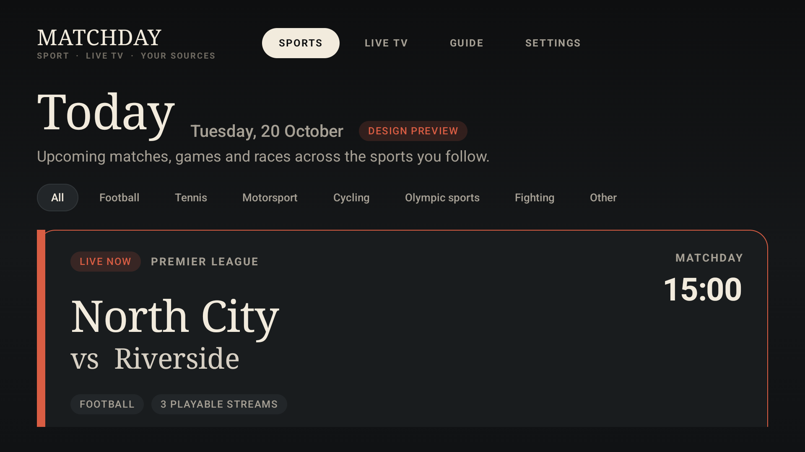
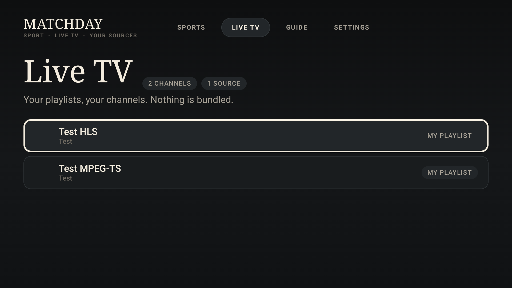
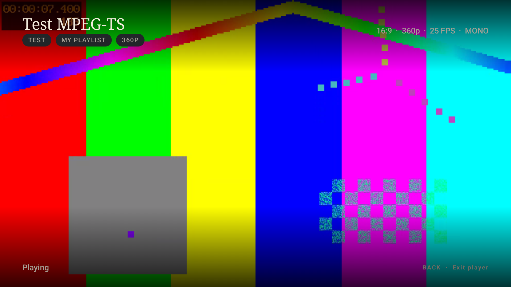
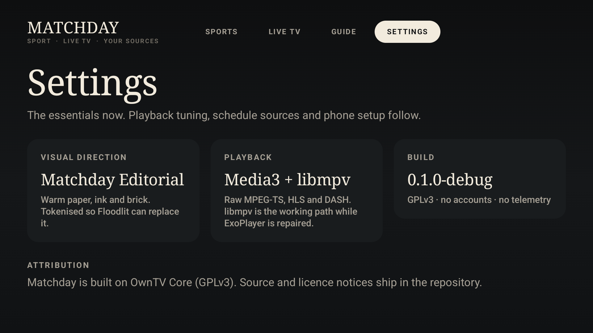

# Matchday

A player-only IPTV app for **Fire TV (Fire OS 7+)** and **Google TV / Android TV**, built around a schedule-first sports hub and a conventional live-TV browser.

Matchday ships with **no channels, playlists, subscriptions, credentials or media**. You bring your own M3U/Xtream source; the app organises it and plays it.

> Working title. The final name and branding are still open.






## Status — milestone 1

Working on an Android TV API 36 emulator:

- Native Kotlin / Compose for TV shell.
- Matchday Editorial theme, tokenised for a future second direction.
- M3U URL import through the headless OwnTV Core engine.
- Channels stored locally and listed with source/category labels.
- HLS and raw MPEG-TS playback through libmpv.
- Local synthetic test server with HLS and TS endpoints.
- Debug-only direct player launch for testing:
  ```bash
  adb shell am start -n dev.matchday.tv.debug/dev.matchday.tv.MainActivity \
    -e debug_url http://10.0.2.2:8088/live/ok.ts
  ```

Not built yet:

- schedule sources and the real Sports Hub (currently a debug design preview),
- channel browser categories / now-next / EPG grid,
- normalisation and categorisation pipeline,
- failover and quality fallback,
- phone-assisted setup,
- release signing and GitHub release workflow polish.

The ExoPlayer live path is present through the core engine but currently reconnects a healthy picture on the emulator due to a frame-watchdog false positive. libmpv is the working playback path for milestone 1; the watchdog fix lands before ExoPlayer becomes the default.

## Build

Requirements:

- JDK 21
- Android SDK 37 + build-tools 37
- Android TV emulator or a Fire OS 7+ / Google TV device

```bash
./gradlew :app:assembleDebug
```

Install and launch:

```bash
./gradlew :app:installDebug
adb shell am start -n dev.matchday.tv.debug/dev.matchday.tv.MainActivity
```

Windows helpers:

```powershell
./scripts/deploy.ps1
./scripts/screenshot.ps1
```

## Local test playlist

```bash
./tools/fault-server/generate_media.sh
python tools/fault-server/server.py --port 8088
```

- Emulator: `http://10.0.2.2:8088/playlist.m3u`
- Real TV over ADB: `adb reverse tcp:8088 tcp:8088`, then `http://127.0.0.1:8088/playlist.m3u`

The debug build pre-fills the emulator URL. The media is synthetic and generated locally; it is not shipped as content.

## Device support

- **minSdk 28** (Fire OS 7 / Android 9).
- Fire OS 7, 8, 14 and 16 Android-based devices.
- Google TV / Android TV.
- Not Fire OS 6 and not Vega OS devices (Fire TV Stick 4K Select, Stick HD 2026, Stick 4K 3rd Gen).
- 32-bit `armeabi-v7a` included for Fire OS 7 sticks.

## Architecture

- `:app` — new Compose for TV shell, theme, navigation and screens.
- `tv.own.owntv:core` / `:player-core` — GPLv3 headless engine from [OwnTV Core](https://github.com/ahXN00/OwnTV_Core), pinned at `core-1.0.68`.
- `third_party/owntv-core` — upstream source submodule for GPL compliance and future patches.
- `tools/fault-server` — synthetic HLS/TS development server.

## Licence

GPLv3. See [LICENSE](LICENSE) and [THIRD_PARTY_NOTICES.md](THIRD_PARTY_NOTICES.md).

Matchday is an independent app. It is not affiliated with or endorsed by any IPTV provider, league, broadcaster or device manufacturer. You are responsible for the sources you add.
