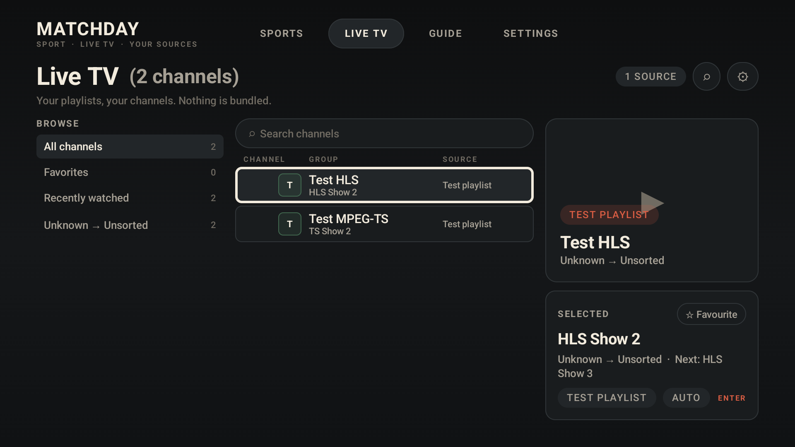
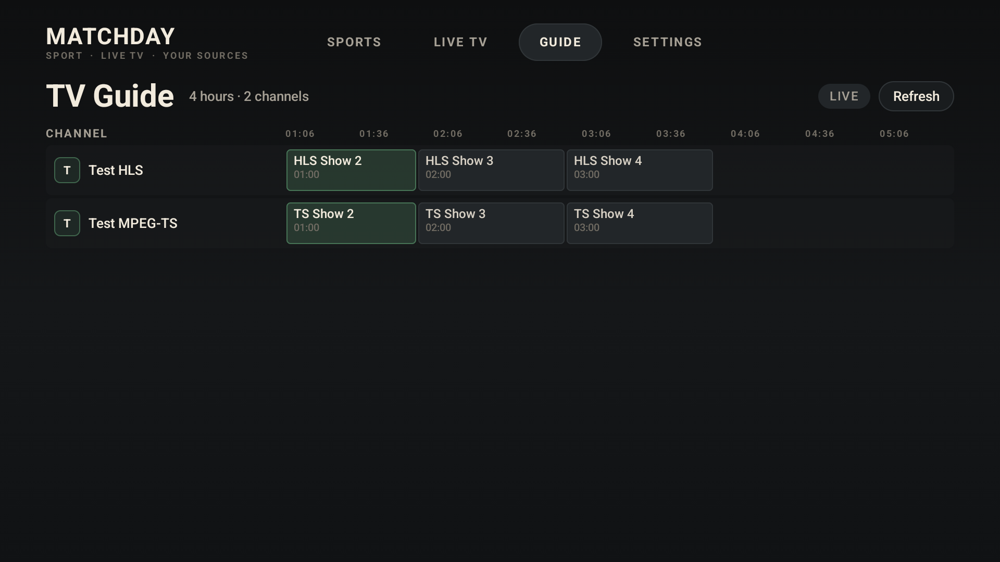

# Matchday

A player-only IPTV app for **Fire TV (Fire OS 7+)** and **Google TV / Android TV**, built around a schedule-first sports hub and a conventional live-TV browser.

Matchday ships with **no channels, playlists, subscriptions, credentials or media**. You bring your own M3U/Xtream source and XMLTV guide; the app organises it and plays it.

> Working title. The final name and branding are still open.

[Download the latest release](https://github.com/mkissarli/matchday-tv/releases)






## What is in v0.1.2

- **Schedule-first Sports Hub** — football (soccer), tennis, motorsport, cycling, Olympic sports and fighting are data-driven registry entries, not enum branches. A seven-day window, date-labelled cards, sport tabs, three headline matches, “Find channels”, and league sections that can be selected or collapsed.
- **Football means association football** — ESPN’s keyless soccer feed supplies European, English and Latin American fixtures. NFL/NCAA is a separate `american-football` sport and never leaks into the Football tab.
- **Tennis lists matches, not tournaments** — ATP/WTA tournament feeds are expanded into the individual scheduled matches via ESPN’s core API; league chips are ATP/WTA and the tournament name travels with the venue line. Biggest names (static ranking proxy) surface in headlines and sort first within the league.
- **Broader motorsport** — F1 race-weekend sessions, IndyCar and the three NASCAR series from ESPN scoreboards; MotoGP from its public event API; Formula 2, Formula 3, IMSA and Supercars from TheSportsDB season feeds.
- **Schedule-only** — ESPN/TheSportsDB schedule fields only. There is deliberately no score, clock, standing or result field in the domain model, and no real-time polling.
- **League-aware ordering** — competition sections are sorted by an approximate static popularity/viewership proxy (Premier League and Champions League first, then the other major leagues and sports), with motorsport series and fighting slotted in below (UFC rank 100, NFL behind them at 150). The league chips select a competition; each section header collapses. The order is deliberately local and does not poll ratings.
- **Headlines bubble the biggest names** — a static elite/strong team-and-player list boosts the most-followed participants into the three headline cards; live matches get a small additional bump and shared-participant duplicates are dropped.
- **Partial refreshes never erase a sport** — if one free schedule provider is rate-limited, cached events for the sports it failed on are preserved and merged; one flaky provider can no longer blank a whole tab.
- **Import diagnostics** — a source whose host cannot be reached says so; the offline wording is reserved for an actually absent connection, and a stuck platform-validation no longer blocks the fetch (OwnTV Core is built from the in-tree fork’s `matchday-diagnostics` branch). The Add Source text fields no longer trap D-pad focus: Down/Up and the keyboard’s Next/Done hand focus to the Import button.
- **Automatic channel catalogue** — M3U import, name normalisation, quality parsing, language/country detection, genre rules, and logical-channel merging with confidence and variant awareness.
- **Live TV browser** — category rail, search, favourites, recently watched, now/next from EPG, and a four-hour guide grid.
- **Resilient playback** — libmpv for HLS and raw MPEG-TS, a quality ceiling (Auto/4K/FHD/HD/SD), variant fallback, cross-channel fixture failover, retry cooldown, failure caps and language priority **English → French → Arabic → German**.
- **Phone-assisted setup** — the TV opens a LAN-only setup page; a phone on the same Wi-Fi enters the pairing code and sends a playlist/EPG URL. No cloud relay and no account.
- **Offline schedule cache** — the last good schedule is stored on the device so the hub opens instantly and survives a rate-limited or offline schedule source.
- **50k+ entries** — the catalogue pipeline has a 50,000-entry regression test and the database snapshot limit is raised to 60,000.

## Device support

- **minSdk 28** (Fire OS 7 / Android 9).
- Fire OS 7, 8, 14 and 16 Android-based devices.
- Google TV / Android TV.
- Not Fire OS 6 and not Vega OS devices (Fire TV Stick 4K Select, Stick HD 2026, Stick 4K 3rd Gen).
- 32-bit `armeabi-v7a` included for Fire OS 7 sticks; `arm64-v8a` for newer hardware.
- No Google Play Services dependency.

## Build

Requirements:

- JDK 21
- Android SDK 37 + build-tools 37
- Android TV emulator or a Fire OS 7+ / Google TV device

```bash
./gradlew :domain:test
./gradlew :app:assembleDebug
```

Install and launch:

```bash
./gradlew :app:installDebug
adb shell am start -n dev.matchday.tv.debug/dev.matchday.tv.MainActivity
```

PC emulator test checklist: [docs/TESTING.md](docs/TESTING.md)

Windows helpers:

```powershell
./scripts/deploy.ps1
./scripts/screenshot.ps1
```

### Release build

Release signing is opt-in. Set these environment variables and point
`MATCHDAY_KEYSTORE` at a keystore path relative to the repository root:

```bash
export MATCHDAY_KEYSTORE=matchday-release.jks
export MATCHDAY_KEYSTORE_PASSWORD=...
export MATCHDAY_KEY_ALIAS=matchday
export MATCHDAY_KEY_PASSWORD=...
./gradlew :app:assembleRelease
```

Without them the release variant falls back to debug signing for local testing.
The GitHub Actions workflow uses repository secrets
`MATCHDAY_KEYSTORE_BASE64`, `MATCHDAY_KEYSTORE_PASSWORD`, `MATCHDAY_KEY_ALIAS`
and `MATCHDAY_KEY_PASSWORD`; a tag such as `v0.1.0` builds and publishes
`matchday-0.1.0.apk` plus its SHA-256 checksum.

## Local test server

```bash
./tools/fault-server/generate_media.sh
python tools/fault-server/server.py --port 8088
```

- Emulator: `http://10.0.2.2:8088/playlist.m3u`
- Real TV over ADB: `adb reverse tcp:8088 tcp:8088`, then `http://127.0.0.1:8088/playlist.m3u`
- Fault playlist: `http://10.0.2.2:8088/fault-playlist.m3u` (first variant returns 404, second is healthy)
- Synthetic EPG: `http://10.0.2.2:8088/guide.xml`

Fault endpoints: `/fault/404`, `/fault/stall`, `/fault/slow`, `/fault/drop`.
Run the server smoke tests with `python tools/fault-server/test_server.py`.

The debug build pre-fills the emulator URL. The media is synthetic and generated
locally; it is not shipped as content.

## Architecture

- `:app` — new Compose for TV shell, theme, navigation, screens, LAN setup server.
- `:domain` — pure Kotlin catalogue, schedule, match and playback policies with JVM tests.
- `tv.own.owntv:core` / `:player-core` — GPLv3 headless engine from [OwnTV Core](https://github.com/ahXN00/OwnTV_Core), pinned at `core-1.0.68`.
- `third_party/owntv-core` — upstream source submodule for GPL compliance and future patches.
- `tools/fault-server` — synthetic HLS/TS/EPG server with fault injection.

### Schedule sources

- Football: ESPN public soccer scoreboard (`soccer/all`) — keyless, with a generated
  219-league id-to-name map for readable sections.
- Motorsport: F1, IndyCar and the three NASCAR series from ESPN scoreboards; MotoGP
  from its public event API; Formula 2, Formula 3, IMSA and Supercars from
  TheSportsDB season feeds — all keyless.
- Tennis: ESPN ATP/WTA scoreboards expanded into individual matches through ESPN's
  core competition API — keyless.
- Fighting/American football: ESPN UFC and NFL scoreboards — keyless.
- Cycling/Olympic/other fallback: TheSportsDB free keyless API — best-effort; the free
  tier is shared and rate-limited, so those tabs can be empty when no free feed exists.
- No paid keys, no real-time scores, no standings.

## Known limitations

- The ExoPlayer live path is present through the core engine but currently reconnects a
  healthy picture on the emulator due to a frame-watchdog false positive. libmpv is the
  default and working path.
- WRC rally and FIA WEC/Le Mans have no reachable keyless schedule feed; they are not
  shown yet.
- Free schedule coverage is necessarily partial. Football and the ESPN-backed sports are
  broad; cycling/Olympic coverage depends on what TheSportsDB publishes and can be empty.
- League order is a static popularity proxy, not live ratings; it is intentionally local
  and can be replaced with a configurable ranking later.
- Phone setup is LAN-only by design. It is not a remote/cloud pairing service.
- Release APKs are published through GitHub Releases, not committed to the repository.
  Build one locally or use the tag-triggered workflow.

## Licence

GPLv3. See [LICENSE](LICENSE) and [THIRD_PARTY_NOTICES.md](THIRD_PARTY_NOTICES.md).

Matchday is an independent app. It is not affiliated with or endorsed by any IPTV
provider, league, broadcaster or device manufacturer. You are responsible for the
sources you add.
